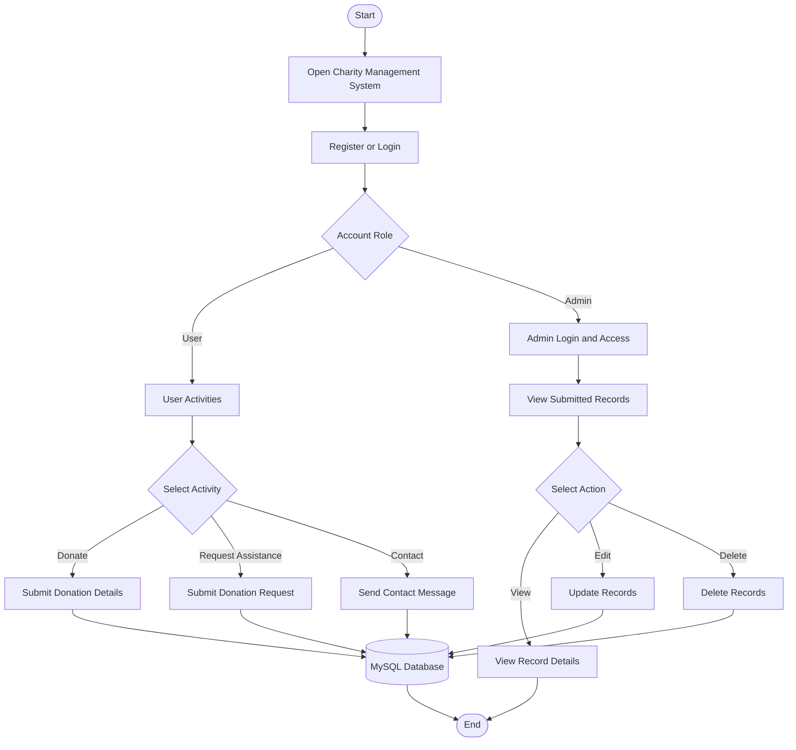

# Charity Management System

## Project Description

The **Charity Management System** is a web-based platform designed to simplify and manage the activities of a charitable organization. It provides a centralized system where users and administrators can interact to support charitable activities.

The system allows users to register and log in. Users can submit donations and request assistance through the platform. Administrators can access submitted records, view details, edit records, and delete records.

## Technologies Used

- **Frontend:** HTML, CSS, JavaScript
- **Backend:** PHP
- **Database:** MySQL
- **Development Tools:** Visual Studio Code, MySQL Workbench, XAMPP (PHP)

## Main Features

### User

- User registration and login
- Submit donation details
- Submit donation requests
- Send contact messages

### Admin

- Admin login
- View donation records
- View donation requests
- View contact messages
- Edit existing records
- Delete records

## System Workflow Diagram

The following diagram illustrates the workflow of the Charity Management System, including user activities, administrator operations, and database interaction.

## Database

The project uses a MySQL database named `charity_management`.

It contains the following tables:

- `sign` – Stores user and administrator account details.
- `donations` – Stores donation information.
- `donation_requests` – Stores requests for assistance.
- `contact_messages` – Stores contact form submissions.

## Security Features

- Password hashing using PHP password hashing functions.
- Password verification during login.
- Session-based authentication.
- Admin access restrictions.
- CSRF token verification for forms.
- Prepared SQL statements.
- Server-side input validation.
- Database credentials stored separately in an ignored configuration file.

## Project Objective

The main objective of this project is to make charity-related activities easier to manage by reducing manual work and maintaining donation and assistance request records in a centralized database.

The system provides a simple platform for users to participate in charitable activities and for administrators to manage submitted information.

## Author

**Developed by:** Channabasappa Gowda B S

**Project:** Charity Management System